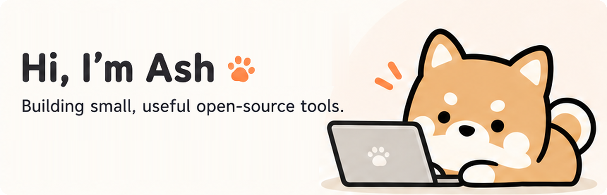
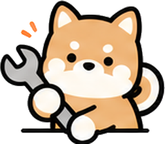
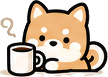
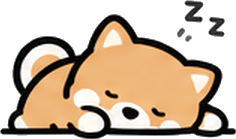

|  |  |  |
|:-:|:-:|:-:|
| **Useful tools** Small, focused tools that solve real problems. | **Explore AI** Using AI to make development more fun and productive. | **Keep it simple** Few dependencies, readable code, works offline. |

### Currently

- **Learning** — AI, automation, and better workflows
- **Interested in** — developer tools and simple design

